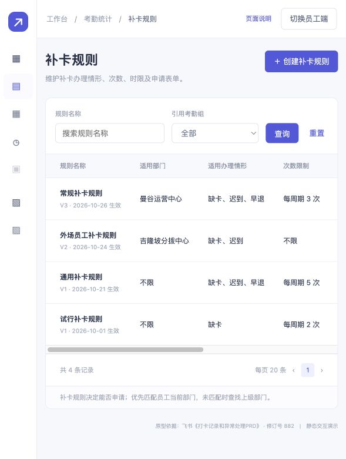

# 考勤结果与异常处理 Demo

基于飞书《打卡记录和异常处理PRD》修订号 882 制作的可点击 HTML 原型。

## 使用

下载仓库后，用浏览器打开 `index.html`，无需安装或联网。

- 考勤统计：补卡规则、打卡记录、异常结果、考勤锁定（占位）。
- 排班：考勤组基础信息。
- 员工端：我的考勤、当日详情与补卡申请。
- 支持表单联动、弹窗、详情、批量编辑入口和导入步骤预览。

所有业务数据均为固定示例；不进行考勤计算、数据持久化或接口调用。查询、保存、更新、导入与导出只展示交互反馈。

详细范围见 [使用说明](使用说明.txt)。

## 预览

